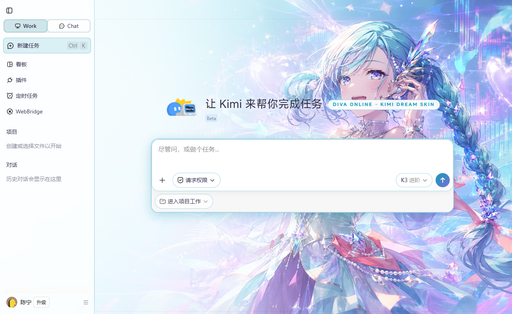
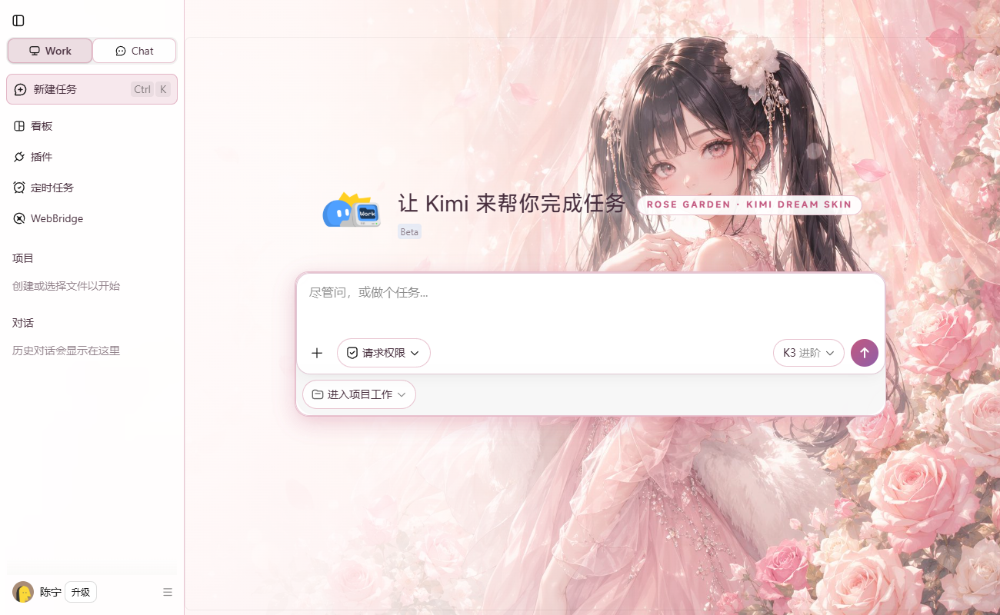
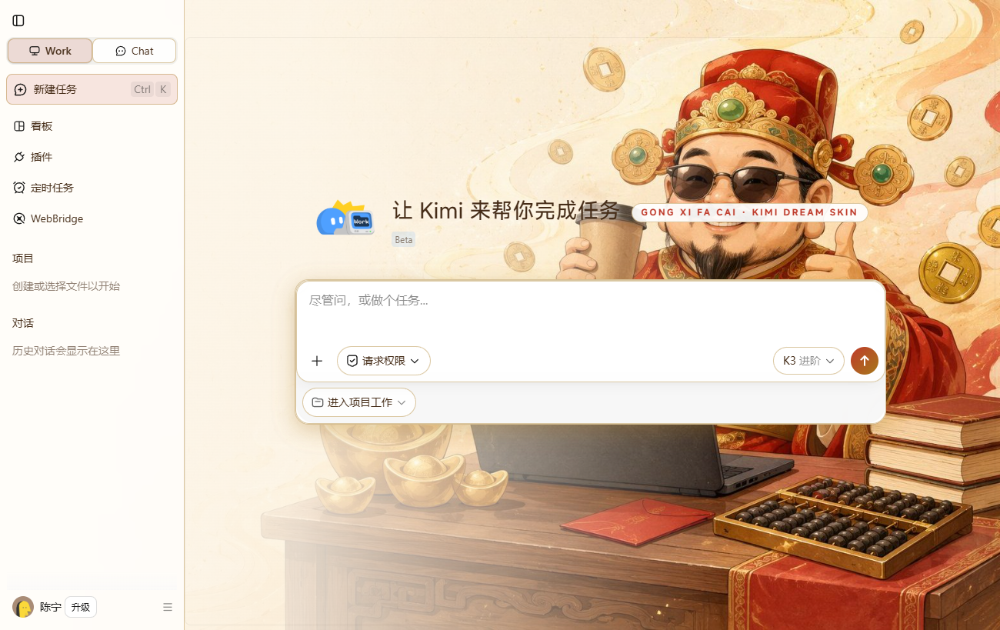
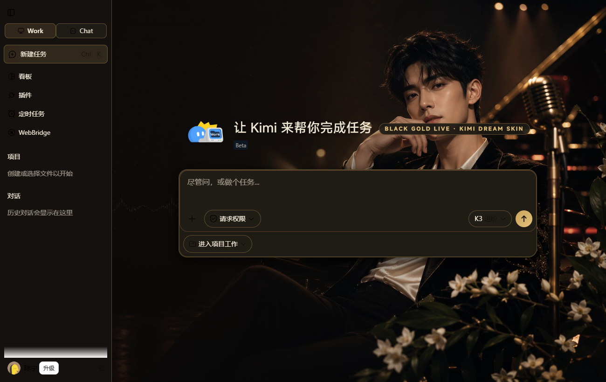
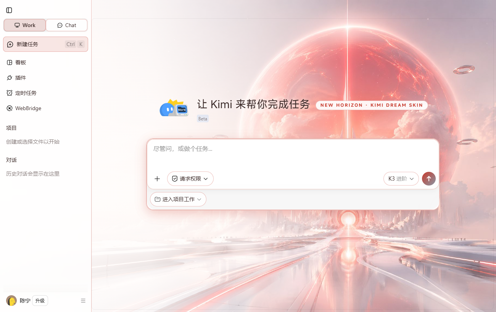
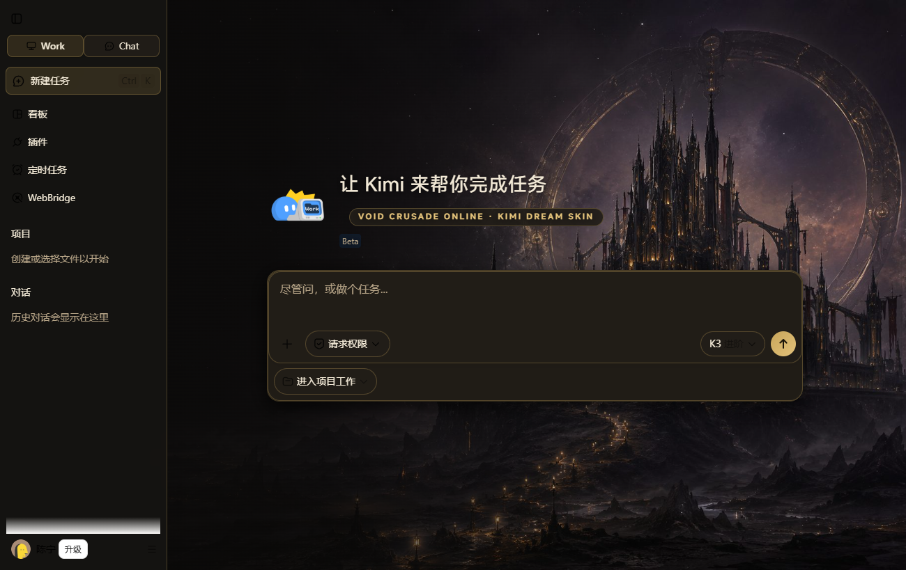

# Kimi Dream Skin

给 **Windows 版 Kimi 桌面客户端** 换肤的开源小工具。思路与规范致敬 [Fei-Away/Codex-Dream-Skin](https://github.com/Fei-Away/Codex-Dream-Skin)（MIT）：Kimi 是 Electron 应用，以 `--remote-debugging-port` 启动后，通过 CDP（Chrome DevTools Protocol）向页面注入主题 CSS——**不改 app.asar、不碰签名、不读写用户数据，重启即恢复原生**。

> 🙏 **致敬**：本项目的设计规范、主题方向与哥特虚空配色均借鉴自 Codex Dream Skin，背景图为按其生图方法论全新生成的原创素材，详细声明见 [NOTICE.md](NOTICE.md)。

| 青蓝歌姬 diva | 粉雾玫瑰 rose | 财神打工 caishen |
| --- | --- | --- |
|  |  |  |
| **舞台黑金 blackgold** | **红白科幻 scifi** | **哥特虚空 gothic** |
|  |  |  |

注入前（原生）：[00-baseline.png](screenshots/00-baseline.png)（以上为登录后主界面实测截图。背景图为 AI 生成的原创角色，设计方向临摹 Codex Dream Skin 的歌姬/粉系/财神主题）

## 特性

- 🎨 六套起手皮肤：青蓝歌姬 / 粉雾玫瑰 / 财神打工 / 舞台黑金 / 红白科幻 / 哥特虚空，2560×1440 级 AI 生成原创角色背景 + 左侧文字安全区遮罩（浅色 ×4 + 暗色 ×2）
- 🖼️ CSS 变量自定义：`--kds-accent` 换主色、`--kds-bg-image` 换任意背景图
- 🔌 零依赖：注入引擎只用 Node 22+ 内置的 `fetch` / `WebSocket`
- 🧭 四个脚本走完全流程：install / start / verify / restore
- ✅ 自带验证：检查注入标记 + 自动截图存证
- 🛟 安全红线：绝不强杀正在运行的 Kimi、调试端口只绑 127.0.0.1、不碰真实 profile

## 环境要求

- Windows 10/11
- Kimi 桌面版（默认安装路径 `%LOCALAPPDATA%\Programs\kimi-desktop\Kimi.exe`，脚本会自动探测）
- Node.js >= 18（建议 >= 22，内置 WebSocket，免装任何 npm 依赖）

## 快速开始（三选一，按你的习惯来）

### 方式 A：双击安装（最简单）

1. 双击仓库根目录的 **`双击我-换肤.cmd`**，按提示选皮肤（1/2/3）。
2. 如果提示 Kimi 正在运行：手动完全退出 Kimi（包括托盘图标），回车重试。
3. 想还原：双击 **`双击我-还原.cmd`**。

### 方式 B：一套提示词（让 Kimi Work 自己装）

打开 [PROMPT.md](PROMPT.md)，把里面的提示词原样发给 Kimi Work，它会读仓库、做环境检查、报方案给你确认后再安装。

### 方式 C：手动命令行

```powershell
cd windows\scripts

# 1) 环境检查（Node 版本 / Kimi.exe 路径 / 皮肤文件）
powershell -ExecutionPolicy Bypass -File .\install-dream-skin.ps1

# 2) 完全退出 Kimi（包括托盘图标），然后启动换肤
powershell -ExecutionPolicy Bypass -File .\start-dream-skin.ps1 -Theme diva

# 3) 验证 + 截图
powershell -ExecutionPolicy Bypass -File .\verify-dream-skin.ps1

# 4) 恢复原生（在线移除皮肤；彻底干净只需正常重启 Kimi）
powershell -ExecutionPolicy Bypass -File .\restore-dream-skin.ps1
```

> ⚠️ Kimi 有单实例机制，皮肤必须在启动时附加调试端口才能注入，所以第 2 步前请先**手动完全退出** Kimi。脚本检测到 Kimi 在运行时只会提示，**绝不会替你强制结束进程**。

## 目录结构

```
kimi-dream-skin/
  README.md                 # 本文件
  NOTICE.md                 # 致敬与第三方声明（Codex Dream Skin 致谢、素材权利）
  PROMPT.md                 # 一套提示词安装方案（发给 Kimi Work 即可）
  双击我-换肤.cmd            # 双击安装入口（皮肤菜单 + 单实例重试引导）
  双击我-还原.cmd            # 双击还原官方外观
  LICENSE                   # MIT
  windows/
    SKILL.md                # 面向 AI agent 的操作说明
    engine/
      cdp.mjs               # 零依赖 CDP 客户端（HTTP /json 发现 + WebSocket 会话）
      inject.mjs            # 注入引擎：--theme 注入 / --watch 驻留 / --remove 移除
      verify.mjs            # 验证注入标记、页面标题/URL，Page.captureScreenshot 截图
      probe.mjs             # DOM 结构探测器（Kimi 更新后重新适配选择器用）
    themes/
      diva.css              # 青蓝歌姬（青蓝全息舞台 + 原创虚拟歌姬）
      rose.css              # 粉雾玫瑰（粉雾柔光花园 + 原创玫瑰少女）
      caishen.css           # 财神打工（宣纸红金 + 原创财神程序员）
      blackgold.css         # 舞台黑金（暗色：近黑舞台 + 原创黑礼服歌手）
      scifi.css             # 红白科幻（珊瑚红能量巨球 + 珍珠白未来城）
      gothic.css            # 哥特虚空（暗色：哥特圣殿之城，配色令牌对齐对方官方预设）
      assets/               # 皮肤背景图（AI 生成，JPEG，注入时自动内联为 data URI）
    scripts/
      common.ps1            # 公共函数（找 Kimi.exe、空闲端口、状态文件）
      install-dream-skin.ps1
      start-dream-skin.ps1
      verify-dream-skin.ps1
      restore-dream-skin.ps1
  docs/
    how-it-works.md         # 原理说明：Electron + CDP 注入，为什么不改 asar
  screenshots/              # 验证截图
```

## 自定义皮肤

复制 `windows/themes/diva.css` 为 `my.css`，改几个变量即可：

```css
:root {
  --kds-accent: #ff7a59;                    /* 主强调色 */
  --kds-bg-image: url("assets/my-bg.jpg");  /* 把图片放进 themes/assets/，注入时自动内联 */
  --kds-bg-pos: 74% 45%;                    /* 背景焦点（人物/主视觉位置） */
}
```

背景图建议 16:9、≥2048 宽，人物/主视觉放在右侧 x=62%~88%，左侧 x=0~52% 保持干净（文字安全区）。

然后 `start-dream-skin.ps1` 的 `-Theme` 参数对应文件名（`-Theme my`，需同时在脚本 `ValidateSet` 里加上名字，或直接用引擎）：

```bash
node windows/engine/inject.mjs --port <端口> --theme my
```

设计约定（所有内置皮肤都遵守）：

- **不盖拦截层**：只重绘原生节点，不在窗口上叠 `pointer-events` 层，所有控件保持可交互。
- **深色皮肤必改文字色**：Kimi 页面 URL 固定带 `theme=light`，深底必须覆盖文字颜色保证可读。
- **登录弹窗保持原生**：`.login-modal` 内的按钮恢复默认配色，不干扰登录流程。
- **稳健选择器**：优先使用已验证的稳定 class（见下方），避免哈希化的动态 class。

### 已验证的关键选择器（Kimi 3.1.2 / Electron 41 实测）

| 区域 | 选择器 |
| --- | --- |
| 主窗口页面 | `app://localhost/kimi-agent.html`（CDP target 标题 "Kimi Agent"） |
| 布局骨架 | `.page`、`.sidebar`、`.main-pane`、`.win-titlebar-drag` |
| 侧栏导航 | `.sidebar-scroll`、`.nav-item`、`.nav-label`、`.section-title`、`.conversation-list` |
| 输入区 | `.composer`、`.composer-box`、`.composer-editor`、`.send-btn`、`.model-picker-trigger` |
| 主页 | `.home-view`、`.home-scroll`、`.hero`、`.greeting`、`.mode-tab` |
| 消息列表 | `.message-list-container`、`.message-list` |
| 弹窗/按钮 | `.login-modal`、`.kimi-button` |

Kimi 更新后选择器失效？跑一次 `node windows/engine/probe.mjs --port <端口>` 重新探测。

## 手动使用引擎

```bash
node windows/engine/inject.mjs --port 9333 --theme diva           # 注入一次
node windows/engine/inject.mjs --port 9333 --theme diva  --watch  # 驻留：新窗口/跳转自动补注入
node windows/engine/inject.mjs --port 9333 --remove               # 在线移除皮肤
node windows/engine/verify.mjs --port 9333 --out shot.png         # 验证 + 截图
node windows/engine/probe.mjs  --port 9333                        # 探测 DOM 结构
```

## 安全说明

- 调试端口一律绑定 `127.0.0.1`。
- 工具不会强制结束任何 Kimi 进程；恢复时也只按状态文件里记录的 PID 操作由本工具启动的实例。
- 不读取、不写入 `%APPDATA%\kimi-desktop` 里的任何文件。
- 注入只发生在内存中，磁盘上的 Kimi 零改动，正常重启即 100% 原生。
- 本项目仅供学习交流，与月之暗面（Moonshot AI）、OpenAI 均无关，非官方产品。设计致敬 Codex Dream Skin，见 NOTICE.md。

## 参与贡献

欢迎 PR：

1. **新皮肤**：在 `windows/themes/` 加一个 `.css`，遵守上面的设计约定，附一张 verify 截图。
2. **选择器适配**：Kimi 更新后用 `probe.mjs` 探测并修复选择器。
3. **跨平台**：目前脚本为 PowerShell（Windows），欢迎贡献 macOS / Linux 版本。

提交前请确认：`install` → `start` → `verify` → `restore` 全流程能跑通，且截图里皮肤确实生效。

## License

[MIT](LICENSE)
