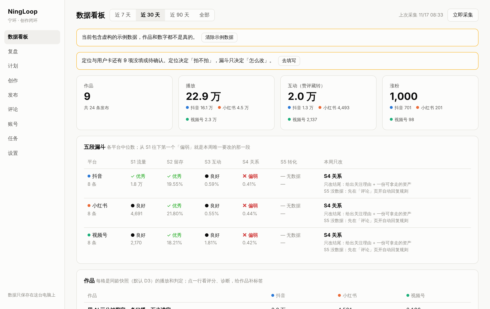
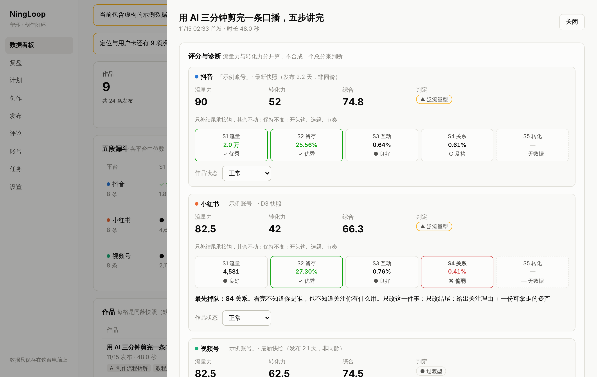

# NingLoop · 宁环

宁少AI进化论的创作闭环工作台，管抖音、小红书、视频号三个平台。在自己电脑上运行，数据只存在本机。

**定位 → 计划 → 创作 → 发布 → 采集 → 复盘 → 下一周计划**，外加评论区承接（第 4 跳「关注 → 私域」）。




截图里是内置的虚构示例数据。

## 复盘怎么算

复盘逻辑按《宁少AI进化论 · 三平台内容数据分析方法论》实现：

- **同龄对比**：每天采集一次，每条作品自动取发布后第 1/3/7 天的快照（D1/D3/D7），默认用 D3 比较；没有 D3 的标成「非同龄」。
- **五段漏斗**：S1 流量 → S2 留存 → S3 互动 → S4 关系 → S5 转化，从上往下第一个「偏弱」的段就是本周唯一要改的事。S5 用评论区领取关键词的条数来测。
- **双引擎评分**：流量力（播放规模分 + 留人分）和转化力（关注 0.5、分享 0.3、评论 0.2）分开算，判成双强型、泛流量型、垂直型、低效型、过渡型五类；状态异常（仅自己可见等）的作品只进待重测。
- **四层标签**：母题、原型、三段钩子、形式参数，全部是封闭字典，发布前打标。复盘时按标签聚合出结构-表现矩阵。
- 阈值和权重都是起始假设，在「设置 → 复盘参数」里可以改，分平台设置。

用 2026-11-10 至 11-16 的五条视频号作品验证过，评分 64.9 / 63.5 / 73.9 / 67.6 / 42.1、首日占比 95.4%、结尾钩 4.6 倍都和文档一致，测试里也包含这组数字。

## 能做什么

| 页面 | 做什么 |
|---|---|
| 数据看板 | 五段漏斗（各平台中位数）、每条作品的同龄播放和判定。点开一条能看评分、漏斗、留存曲线和来源结构，并给历史作品补标签、标记异常状态 |
| 对标 | 盯住同赛道的号（抖音、小红书、视频号），通过 TikHub 每天读一次它们的公开作品。互动量达到该号中位数 N 倍（默认 3 倍）的算爆款。爆款可以打和自己作品同一套结构标签，也可以让 AI 拆解；拆解过的一键变成「创作」里的选题，或进入下周计划。页面上能看到每天大约花多少钱 |
| 复盘 | 规则复盘按顺序出：定位检查 → 数据校验 → 漏斗 → 单条判定 → 四个判断 → 结构矩阵 → 上期计划验收 → 评论区信号 → 下一步。配置大模型后可以出 AI 复盘 |
| 计划 | 按决策表生成本周选题：双强型做系列续集；泛流量型做同结构续作、只补结尾钩；垂直型换壳扩曝光；异常的待重测。再加一个没做过的母题和一个评论区高频提问。每条都带目标指标和验收口径，每周最多 3 条 P0。可以用 AI 把方向写成具体标题 |
| 创作 | 两套工作流各一块看板：**选题直出**（AI 全自动生成）和**口播剪辑**（录口播 → 用组件和 Skill 让 AI 剪）。每个阶段有检查项；可以按原型生成四段脚本骨架，或者用 AI 写脚本、口播稿和标题 |
| 发布 | 一份视频或图文，勾选账号一次排队发出，支持定时，视频号可存草稿。从创作页带着选题去发布，采集到数据后会自动关联并验收 |
| 评论 | 抓抖音、视频号的评论（小红书手动粘贴），按规则生成回复草稿。默认规则是「评论区打 skill → 回复领取方式」，模板会随机组合，避免每条一样。确认后发出，或复制后手动回复；评论里的提问会进下周计划 |
| 设置 | 定位与用户卡（已按近期作品填了初稿，标「待确认」）、复盘参数、两套工作流的阶段、采集和大模型设置，以及导入《内容数据工作台.xlsx》 |

## 安装（Windows）

1. 安装 [Python 3.12](https://www.python.org/downloads/release/python-3129/)，安装时勾选 **Add python.exe to PATH**。发布引擎只支持 Python 3.10 – 3.12。
2. 下载本仓库并解压（或 `git clone`）。
3. 双击 **`安装.cmd`**。它会创建虚拟环境，下载发布引擎 [social-auto-upload](https://github.com/dreammis/social-auto-upload)，再安装依赖和 Chromium 浏览器。第一次需要几分钟。
4. 双击 **`启动.cmd`**，浏览器会打开 `http://127.0.0.1:8765`。关掉那个黑色窗口，工作台就停了。

## 第一次使用

1. 「设置」页：先改定位与用户卡，再导入已有的《三平台内容数据工作台.xlsx》，历史数据和标签就能直接进复盘。
2. 「账号」页：添加账号并扫码登录。登录一次，发布、采集、抓评论都能用。
3. 「设置 → 对标账号」：填 TikHub API Key，然后到「对标」页添加几个对标号。抖音、小红书填主页链接；视频号可以填视频号 ID（sph 开头）、finder username 或账号名。
4. 「数据看板」：点「立即采集」。之后工作台开着时每天自动采集；不想一直开着，可以双击 `设置每日自动采集.cmd`。
5. 「评论」页：确认领取规则里的关键词和回复模板。
6. 「计划」页：点「按数据生成本周计划」，然后在「创作」页推进，在「发布」页发出。

## 需要知道的限制

- **采集和评论依赖各平台创作者后台的内部接口和页面**，没有公开文档。平台改版后可能需要调整 `workbench/collect.py` 和 `workbench/comments.py`。失败时，「任务」页的日志会说明是哪一步；评论的原始响应存在 `data/raw/comments/`。
- **评论自动发送是实验性的**：它靠页面上的文字找到原评论再回复，发送失败的会退回草稿。小红书只出草稿，不自动发。回复里不要留微信号、手机号或外链。
- 对标账号的数据来自 TikHub，**每次读取都按次扣费**：抖音约 $0.001，小红书约 $0.002，视频号 $0.01。每个号每天读一页，10 个号一天大约几分钱到一毛钱。公开数据里多半没有播放量，所以爆款按互动量判断，不和自己账号的播放比。
- 小红书对自动发布也比较敏感，发布时建议保持显示浏览器窗口。
- 阈值是起始假设。样本少于 3 条的分组只能当假设；累计 4 周后，用自身分位数重设阈值。
- 只用于你自己的账号，请遵守各平台的用户协议。

## 命令行

```bash
.venv\Scripts\python.exe -m workbench            # 启动
.venv\Scripts\python.exe -m workbench collect    # 采集所有已登录账号
.venv\Scripts\python.exe -m workbench review --days 7
.venv\Scripts\python.exe -m workbench comments --platform douyin --account 主号
```

## 项目结构

```text
workbench/
  method.py     方法论：封闭字典、组合规则、脚本骨架、阈值、判定表、定位卡
  collect.py    读取三个平台后台的数据       ingest.py    整理进 SQLite
  analytics.py  同龄快照、五段漏斗、双引擎评分、矩阵、校验
  review.py     规则复盘与 AI 复盘           planner.py   下一步创作计划
  contents.py   两套工作流、选题、验收       comments.py  评论抓取、规则、回复
  importer.py   导入《内容数据工作台.xlsx》   jobs.py      任务队列（发布调用 social-auto-upload）
  tikhub.py     TikHub 接口                  benchmarks.py 对标账号、爆款、拆解、复刻
  server.py     本地网页服务（只监听 127.0.0.1）
web/            界面（单页，无需构建）
tests/          测试，含一个模拟三个平台后台和评论页的假站点
```

`data/`（你的数据、定位卡、密钥）和 `vendor/`（发布引擎和登录状态）都不会进 git。

## 测试

```bash
.venv/bin/python -m pip install pytest
.venv/bin/python -m pytest tests
```

采集、抓评论和自动回复的测试会启动真实的 Chromium，访问 `tests/fake_platforms.py` 里的假后台。它们验证的是流程本身，代替不了在真实平台上的验证。

## 致谢

见 [NOTICE.md](NOTICE.md)。MIT 许可。
